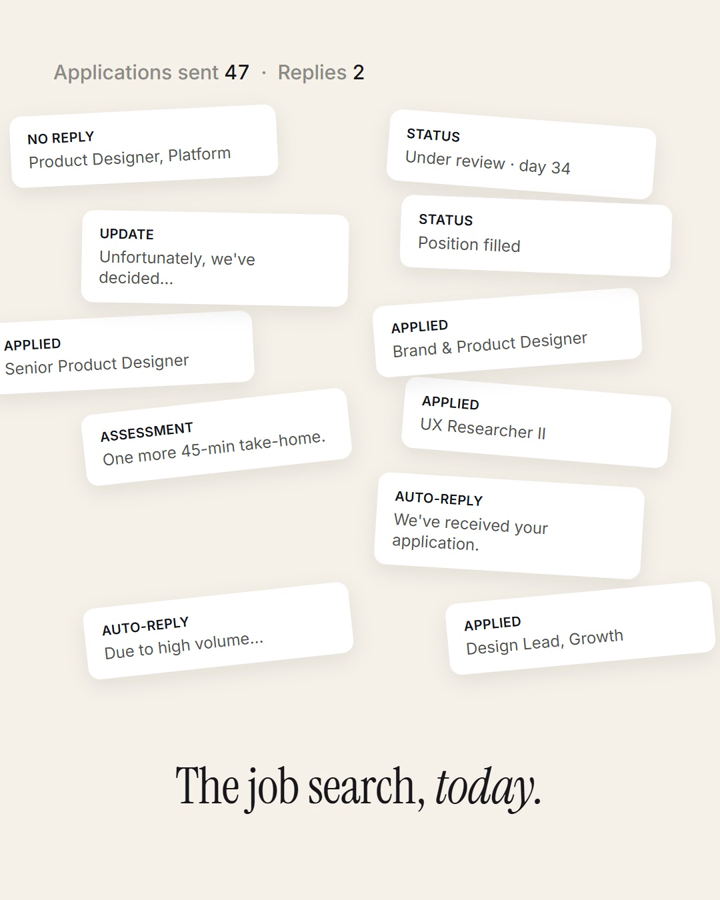
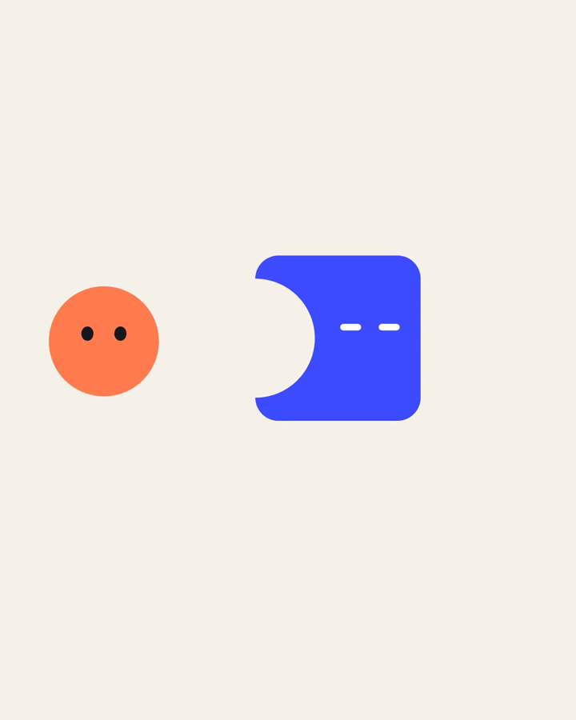
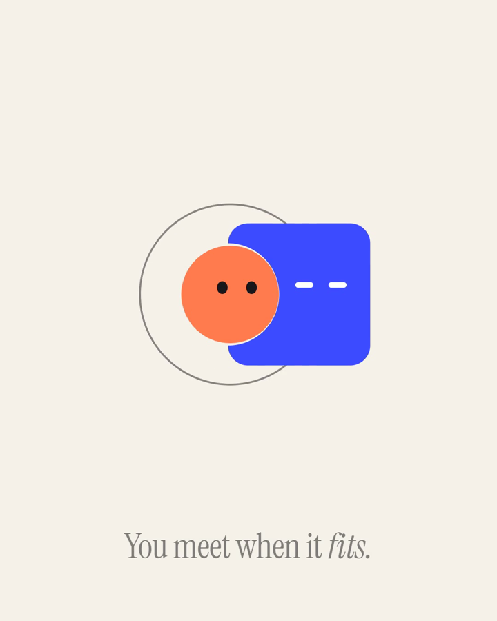
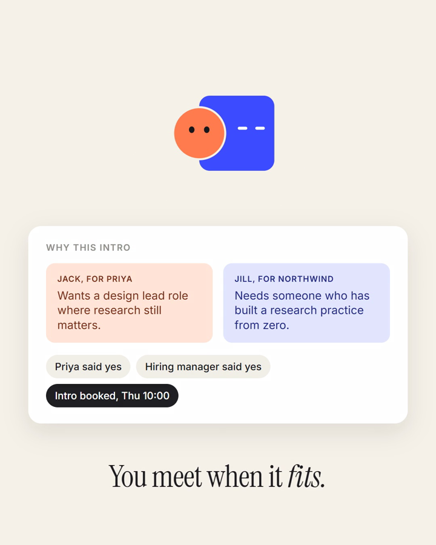

# Jack & Jill Concept Ideas

> **⚠️ For pitching only.** These are unofficial, speculative concepts created by Sneha Baid as part of a pitch. They are **not being used by Jack & Jill**, and are not affiliated with, commissioned by or endorsed by the company. Names shown in the video (Priya, Northwind) are fictional. All brand names belong to their respective owners.

**Credits:** Independent concept, art direction, design, motion, and accessibility framing by Sneha Baid; AI used as a supporting ideation/build tool.

## ▶️ Watch the finished piece (26 seconds)

  

  <b><a href="https://github.com/snehabaid1998-byte/Jack-Jill-concept-ideas/blob/main/two-agents-one-handshake/two-agents-one-handshake-4x5.mp4">▶️ Watch the full-quality video (MP4, 1080 × 1350, 26s)</a></b> 
  Looping preview above (silent, like the original). Click it to open the full video.

**More:** [Transcript](two-agents-one-handshake/TRANSCRIPT.md) · [Static storyboard (no motion)](two-agents-one-handshake/storyboard.png) · [Web page](https://snehabaid1998-byte.github.io/Jack-Jill-concept-ideas/)

---

## Concept 01: Two Agents, One Handshake

**Format:** 26-second silent social video, 1080 × 1350 (4:5 feed format)
**Line:** *Your career has an agent now.*

### The idea in one sentence
Job hunting today is a pile of applications nobody answers; Jack & Jill replace that pile with two agents who talk first, so the people only meet when both sides already fit.

### Brand rationale

**It extends the dual-agent idea instead of inventing a new one.** Jack & Jill's product is already built on two agents: Jack works for the candidate, Jill works for the company, and they work together to make introductions. The concept turns that structure into the story itself. Each agent gets one line that says who it is loyal to (*"He works for you." / "She works for the team."*), and the plot is simply the two of them meeting.

**Two characters, two shapes, one fit.** Jack is a warm orange circle. Jill is a cool blue square with a circular notch cut out of one side, a space exactly the size of Jack. They are designed as two halves of one mark. Neither is complete alone, and the fit only happens when the conversation has happened first. The product promise (a good match) is built into the character design rather than stated in copy.

**The human–AI relationship: agents do the legwork, humans make the call.** The agents never decide for anyone. The "Why this intro" card shows each agent's reasoning in plain language, then two consent chips appear in sequence, *Priya said yes* and *Hiring manager said yes*, before *Intro booked*. The message is that AI handles the noise and the back-and-forth, while people keep the final say. That is the trust question every AI recruiting product has to answer, and the film answers it visually.

**From noise to signal.** The opening rebuilds the real job-search experience as UI cards: auto-replies, "under review, day 34", "position filled", a counter that climbs to 47 applications while replies stay stuck at 2. It names the pain before naming the product, so the agents arrive as relief rather than as a feature list.

### Design process

#### Key frames

| 1. The problem | 2. They talk first | 3. The handshake | 4. Why this intro |
|---|---|---|---|
|  |  |  |  |

Full beat-by-beat storyboard: [storyboard.png](two-agents-one-handshake/storyboard.png)

#### Visual references and language
- **The job search itself.** The opening cards are rebuilt from the artefacts every applicant recognises: ATS status emails, auto-replies, take-home assessment requests. Recognition comes before any branding.
- **The brand's own two-agent story.** The narrative structure follows how Jack & Jill already describe themselves: one agent per side, working together to introduce people.
- **Flat geometric characters.** Two primitive shapes with minimal faces (dot eyes for Jack, dash eyes for Jill) so they read as friendly and non-human at the same time. They are helpers, not imitation people.
- **Editorial type.** A condensed serif headline with one word in italic per line (*today, for you, for the team, first, fits, agent*). The italic carries the emphasis, so each line can be read in a glance on a muted feed.
- **Warm paper to dark resolve.** A warm off-white background for the story, switching to near-black for the end line, so the close feels like a lockup rather than another scene.

#### Motion logic
| Time | Beat | Motion decision |
|---|---|---|
| 0–4s | The job search, today. | Status cards accumulate at slight random angles; the applications counter climbs while replies stay at 2. Clutter and repetition create the feeling of overload. |
| 5–8s | Meet Jack. He works for you. | Screen clears to one character. His question types out letter by letter (*"What do you actually want next?"*) so he reads as someone listening, not broadcasting. |
| 9–11s | Meet Jill. She works for the team. | Same entrance pattern from the other side (*"I know what this team really needs."*). Mirrored timing makes them equals. |
| 12–14s | They talk first. | The two move toward each other on one horizontal axis. A dotted line between them stands in for the conversation the user never has to sit through. |
| 15–16s | The handshake. | Jack slides into Jill's notch and a single ring pulses outward from the join. This is the one moment of emphasis in the film. |
| 17–22s | Why this intro. | The pair scales down and moves up to make room for the reasoning card. Consent chips appear one at a time, then *Intro booked*. Each step is sequential so the order of trust is clear. |
| 23–26s | Your career has an agent now. | Background fades to dark, characters hold as a joined mark above the line and the Jack & Jill name. |

#### Why the handshake is the central metaphor
- **It is how introductions work between people.** A handshake is the moment two parties agree to meet. Jack & Jill exist to arrange exactly that moment, so the metaphor describes the product without a single feature callout.
- **It needs both sides.** You cannot shake hands alone. The shapes make this literal: the circle and the notch only complete each other, which mirrors a two-sided marketplace where a match must work for candidate and company.
- **It is agreement, not automation.** The handshake happens between the agents, but the next frames show both humans saying yes. The agents shake hands on your behalf; you still choose whether to walk through the door.
- **It survives on mute and at small sizes.** A shape clicking into place reads instantly on a phone feed with no sound and no copy, which is where a 4:5 social cut lives.

### Accessibility decisions

**In place now**
- ✅ **Does not rely on sound.** The video has no audio track. Every story beat is carried by on-screen text and visuals, so nothing is lost when it autoplays muted in a feed.
- ✅ **Transcript.** A full timed transcript of all on-screen text and key visual actions: [TRANSCRIPT.md](two-agents-one-handshake/TRANSCRIPT.md).
- ✅ **Static alternative.** A no-motion storyboard of all eight beats with captions: [storyboard.png](two-agents-one-handshake/storyboard.png). The web page shows it next to the video and moves it first for visitors who have reduced motion turned on.
- ✅ **No autoplay on the web page.** The video only plays when the viewer presses play. The README preview is an animated image, which GitHub pauses for visitors who have reduced motion turned on.
- ✅ **Alt text** on every frame image in this README and on the web page.

**Planned, not yet done**
- ⏳ **Captions file (WebVTT).** Not needed for speech, since there is none, but planned as an audio-description track for screen-reader users if a voiceover cut is made.
- ⏳ **Photosensitivity check** (flash and motion-intensity review) for the full cut.
- ⏳ **Formal colour-contrast audit** of the small text inside the speech bubbles and UI cards against WCAG AA, and size check of that text on small phone screens.
- ⏳ **Reduced-motion video cut,** a version with cross-fades in place of the card scatter and character slides.
- ⏳ **Captioned voiceover version,** if a narrated cut is produced.

---

**Credits:** Independent concept, art direction, design, motion, and accessibility framing by [Sneha Baid](https://www.linkedin.com/in/-snehabaid); AI used as a supporting ideation/build tool.

Pitch material only; not an official Jack & Jill asset.
